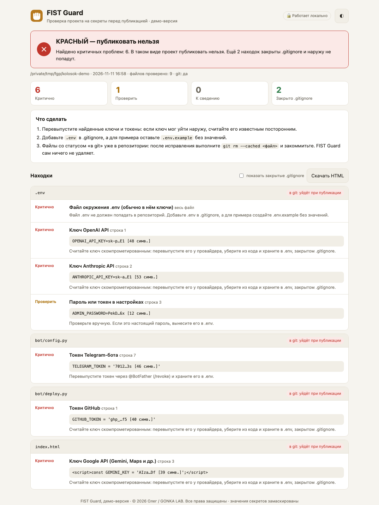
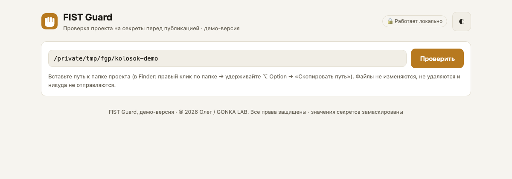

# FIST Guard — демонстрационная версия

**Проверка проекта на секреты перед публикацией.** Работает локально, без зависимостей.

> Это **демонстрационная версия** авторского продукта GONKA LAB, опубликованная как выпускной проект курса ZeroCoder CLm04. Она полностью работает, но набор правил и функций ограничен. Полная версия FIST Guard не публикуется.



## Проблема

Ключ OpenAI в `index.html`, токен Telegram-бота прямо в коде, файл `.env`, случайно попавший в репозиторий. Утёкший ключ API за ночь выбирают до лимита, а перехваченным ботом пишут от вашего имени. Чаще всего такие ошибки делают те, кто собирает сайты и ботов с помощью ИИ и не проверяет, что уходит на GitHub.

## Для кого

Фрилансеры, вайб-кодеры и небольшие команды, которые публикуют проекты на GitHub или передают код заказчику. Чтобы понять отчёт, не нужно быть программистом.

## Что делает демо-версия

**На входе:** путь к папке проекта.
**На выходе:** заключение-светофор, список находок с замаскированными значениями и пункты «Что сделать». Результат показывается в браузере, в терминале, в HTML-файле или в JSON.

| Возможность | В демо-версии |
|---|---|
| Ключи OpenAI, Anthropic, Google/Gemini, токены GitHub и Telegram, закрытые ключи | ✅ |
| Пароли и токены в настройках (`PASSWORD = "…"`, строки в `.env`) | ✅ уровень «проверить» |
| Файлы `.env`, `id_rsa`, `*.pem`, `*.key`, `*.p12` | ✅ |
| Учёт git и `.gitignore`: уйдёт ли находка при публикации | ✅ |
| Маскирование: значения никогда не показываются целиком (`sk-p…E1 [48 симв.]`) | ✅ |
| Веб-интерфейс, светлая и тёмная тема, мобильная вёрстка | ✅ |
| Отчёты: терминал, HTML, JSON; коды выхода для автоматизации | ✅ |
| Встроенный демо-проект с выдуманными ключами | ✅ |
| Claude Skill для Claude Code | ✅ |
| Поиск секретов в истории git, персональные данные, расширенные правила и подавление ложных срабатываний, Markdown-отчёт | ❌ только в полной версии |

### Заключение

| | Значит | Код выхода |
|---|---|---|
| 🟢 **ЗЕЛЁНЫЙ** | Автоматическая проверка не нашла секретов, которые уйдут при публикации | `0` |
| 🟡 **ЖЁЛТЫЙ** | Критичного нет, но есть пароли, которые надо проверить вручную | `1` |
| 🔴 **КРАСНЫЙ** | Найден ключ, токен или `.env`, который уйдёт наружу | `2` |

**FIST Guard только читает:** не изменяет, не удаляет файлы и ничего не отправляет в интернет. Веб-интерфейс работает только на вашем компьютере (`127.0.0.1`). Автоматическая проверка снижает риск, но не гарантирует, что секретов нет.

## Быстрый старт

Нужен Python 3.9+ и git.

```bash
git clone https://github.com/textsmen-design/fist-guard.git
cd fist-guard

# 1. Создать демо-проект «Пекарня Колосок» с выдуманными ключами
python3 -m fist_guard demo ./kolosok-demo

# 2. Проверить его в терминале → КРАСНЫЙ
python3 -m fist_guard scan ./kolosok-demo

# 3. Открыть визуальный интерфейс в браузере
python3 -m fist_guard ui ./kolosok-demo
```

Остановить интерфейс: `Ctrl+C` в терминале.



### Что вы увидите на демо-проекте

- 🔴 КРАСНЫЙ: ключи OpenAI и Anthropic в `.env`, который попал в git; токен Telegram в коде бота; ключ Gemini прямо в HTML; токен GitHub в скрипте;
- 🟡 пароль администратора в `.env` нужно проверить вручную;
- 🟢 файл `logs/secret.env` закрыт `.gitignore` и наружу не попадёт;
- строка `os.getenv('OPENAI_API_KEY')` и файл `.env.example` правильно **не** считаются проблемой.

### Команды

```bash
python3 -m fist_guard scan <папка>                     # отчёт в терминале
python3 -m fist_guard scan <папка> --html report.html  # + автономный HTML-отчёт
python3 -m fist_guard scan <папка> --format json       # JSON для автоматизации
python3 -m fist_guard ui [<папка>]                     # интерфейс в браузере
python3 -m fist_guard demo [<куда>]                    # демо-проект
```

Можно установить как команду: `pip install .`, после этого `fist-guard scan <папка>`.

## Claude Skill

Скилл лежит в [`.claude/skills/fist-guard/SKILL.md`](.claude/skills/fist-guard/SKILL.md). Если открыть Claude Code в папке репозитория, он подхватит скилл сам. Попросите:

> «Проверь ./kolosok-demo перед публикацией»

Claude запустит FIST Guard, объяснит находки простыми словами и предложит план исправлений. Применяет он их только с вашего согласия и никогда не показывает ключ целиком.

## Технологии

Python 3.9+, только стандартная библиотека (`re`, `subprocess`, `http.server`, `argparse`); git CLI в режиме только чтения; интерфейс — одна HTML-страница на чистом JavaScript без внешних библиотек и CDN; тесты — pytest.

```
fist_guard/
  rules.py     правила поиска
  scanner.py   обход папки, git-статус, заключение
  masking.py   маскирование значений
  report.py    терминал, JSON, HTML
  server.py    локальный веб-интерфейс (127.0.0.1, токен сессии, проверка Host)
  web/         интерфейс
  demo.py      демо-проект; выдуманные ключи собираются при запуске
tests/         33 автотеста
```

## Тесты

```bash
pip install pytest
python3 -m pytest -q
# 33 passed
```

Тесты проверяют каждое правило, типичные ложные срабатывания, статусы git, защиту веб-сервера, а также то, что **сканирование не меняет файлы** и что **ни один отчёт не содержит секрет целиком**.

## Автор и права

**© 2026 Олег / GONKA LAB. Все права защищены.**

Выпускной проект курса «Практический курс по вайб-кодингу на Claude Code» (ZeroCoder, CLm04), разработан вместе с Claude Code. FIST Guard — первый продукт системы FIST цифровой лаборатории GONKA LAB.

Код открыт для просмотра и запуска в учебных целях. Коммерческое использование, изменение и распространение без письменного разрешения автора запрещены. Подробности в [LICENSE](LICENSE).
